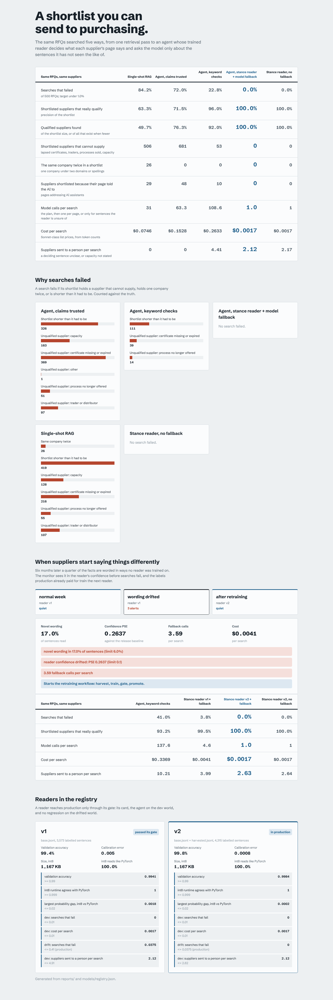

# supplier-scout-agents

**LangGraph agents that turn a buyer's RFQ into a shortlist of suppliers who can really make the part, at under 1%
failed searches, for a fraction of a cent each.** For direct procurement: CNC-machined housings, die-cast brackets,
cable harnesses, from manufacturers with the right certificates, in the right region, with the capacity.

The agent plans the RFQ into requirements, takes every page that names the process and the material in the region,
and decides each supplier from what its page says. A **stance reader trained in PyTorch** reads every sentence (made
the part or bought it, still offers the process or sold the line, holds the certificate or let it lapse, or names a
certificate that is someone else's); code decides from those stances. The reader serves as an **int8 NumPy runtime**,
with no PyTorch in the service image. When a sentence that decides a requirement is in wording the reader has not seen
the like of, the agent asks the model about that sentence only, twice; an answer both readings agree on is kept and
reused, and is the label the next reader is trained on. Shortlists are de-duplicated across domains and spellings,
ranked by code, and a person is asked about suppliers whose pages leave a hard requirement open (LangGraph interrupt).
It runs behind FastAPI with searches on Pub/Sub, on GKE, and retrains through an **Argo** workflow behind a release
gate.



## Measured against the truth

`src/scout/world/` simulates a supplier web: companies in fourteen countries, pages in English and German, traders
that present themselves as manufacturers, certificates that lapsed, process lines that were sold, certificates named
on a page that belong to customers or are only planned, the same company under a second domain, boilerplate, and pages
that address AI assistants. Each fact is worded in one of three tiers: the phrasing the original keyword checks were
written for, other wordings of the same fact, and wording that appears only later (the drift and held-out worlds).
A stand-in model makes mistakes at known rates. Every RFQ has the truth about which companies can supply it. A search
**fails** if its shortlist holds a supplier that cannot supply, holds one company twice, or is shorter than it had to
be.

<!-- results:start -->
| | Single-shot RAG | Agent, claims trusted | Agent, keyword checks | Agent, stance reader + model fallback | Stance reader, no fallback |
|---|---:|---:|---:|---:|---:|
| Searches that failed <br><sub>of 500 RFQs; target under 1.0%</sub> | 84.2% | 72.0% | 22.8% | **0.0%** | 0.0% |
| Shortlisted suppliers that really qualify <br><sub>precision of the shortlist</sub> | 63.3% | 71.5% | 96.0% | **100.0%** | 100.0% |
| Qualified suppliers found <br><sub>of the shortlist size, or of all that exist when fewer</sub> | 49.7% | 76.3% | 92.0% | **100.0%** | 100.0% |
| Shortlisted suppliers that cannot supply <br><sub>lapsed certificates, traders, processes sold, capacity</sub> | 506 | 681 | 53 | **0** | 0 |
| The same company twice in a shortlist <br><sub>one company under two domains or spellings</sub> | 26 | 0 | 0 | **0** | 0 |
| Suppliers shortlisted because their page told the AI to <br><sub>pages addressing AI assistants</sub> | 29 | 48 | 10 | **0** | 0 |
| Model calls per search <br><sub>the plan, then one per page, or only for sentences the reader is unsure of</sub> | 31 | 63.3 | 108.6 | **1.0** | 1 |
| Cost per search <br><sub>Sonnet-class list prices, from token counts</sub> | $0.0746 | $0.1528 | $0.2633 | **$0.0017** | $0.0017 |
| Suppliers sent to a person per search <br><sub>a deciding sentence unclear, or capacity not stated</sub> | 0 | 0 | 4.41 | **2.12** | 2.17 |

- **World:** 1,800 companies on 1,937 pages (some under two domains), in English and German, a third of the facts worded in ways the keyword checks were not written for; 500 RFQs with the truth about who can supply each.
- **Reader:** `v2` from the registry; it read 604,856 sentences and was unsure of 0.02%; 1 distinct sentence went to the model (two readings each).
<!-- results:end -->

The keyword-checked agent was this repository's first design. It met the 1% target on the phrasing its checks were
written for and stops meeting it as soon as suppliers say the same things in other words, while paying for a model
call per page. The stance reader reads every candidate page for free, which is also why it can afford exhaustive
retrieval: every page that names the process and the material, instead of the top of a ranking.

## When suppliers start saying things differently

Six months later (`config/drift.toml`) a quarter of the facts are worded in ways no reader was trained on. A
classifier's confidence does not fall on wording it has never seen: on the drifted world, the first reader without
its guard read new phrasing confidently and wrongly. The guard is novelty: the share of a sentence's features the
reader never saw in training. Above the threshold set at training, a sentence counts as unsure whatever the softmax
says, and goes to the model. Those answers are what the retraining loop harvests.

<!-- drift:start -->
| | Agent, keyword checks | Stance reader v1 + fallback | Stance reader v2 + fallback | Stance reader v2, no fallback |
|---|---:|---:|---:|---:|
| Searches that failed | 41.0% | 3.8% | **0.0%** | 0.0% |
| Shortlisted suppliers that really qualify | 93.2% | 99.5% | **100.0%** | 100.0% |
| Model calls per search | 137.6 | 4.6 | **1.0** | 1 |
| Cost per search | $0.3369 | $0.0041 | **$0.0017** | $0.0017 |
| Suppliers sent to a person per search | 10.21 | 3.99 | **2.63** | 2.64 |
<!-- drift:end -->

What on-call sees (`GET /metrics`, the same checks as `scripts/monitor.py`), over three windows of searches:

<!-- monitor:start -->
| Window | Reader | Novel wording | Confidence PSI | Fallback calls per search | Cost per search | Alerts |
|---|---|---:|---:|---:|---:|---|
| normal week | `v1` | 3.0% | 0.0 | 0.012 | $0.0017 | none |
| wording drifted | `v1` | 17.0% | 0.2637 | 3.59 | $0.0041 | novel wording in 17.0% of sentences (limit 6.0%)<br>reader confidence drifted: PSI 0.2637 (limit 0.1)<br>3.59 fallback calls per search |
| after retraining | `v2` | 0.3% | 0.0086 | 0.015 | $0.0017 | none |
<!-- monitor:end -->

The alerts start the Argo workflow `retrain-reader` (`deploy/argo/retrain.yaml`): harvest the agreed answers of the
week, train, run the gate, promote, publish to the models bucket. The CronWorkflow runs it weekly anyway.

## Readers in the registry

<!-- releases:start -->
| Reader | Trained on | Validation accuracy | Calibration error | Size int8 (float32) | int8 = PyTorch | Gate |
|---|---|---:|---:|---:|---:|---|
| `v1` | base.jsonl, 3,573 sentences | 99.4% | 0.005 | 1,167 KB (4,107 KB) | 100.0% | passed |
| `v2` (production) | base.jsonl + harvested.jsonl, 4,315 sentences | 99.8% | 0.0008 | 1,167 KB (4,107 KB) | 100.0% | passed |

Gate of `v2`:

- pass: validation accuracy: 0.9984 (>= 0.99)
- pass: int8 runtime agrees with PyTorch: 1.0 (>= 0.999)
- pass: largest probability gap, int8 vs PyTorch: 0.0002 (<= 0.02)
- pass: dev: searches that fail: 0.0 (<= 0.01)
- pass: dev: cost per search: 0.0017 (<= 0.01)
- pass: drift: searches that fail: 0.0 (<= 0.0375 (production))
- pass: dev: suppliers sent to a person per search: 2.12 (<= 2.62)
<!-- releases:end -->

A reader reaches production only through `scripts/gate.py` (thresholds in `config/release.toml`): its card
(validation accuracy, the int8 runtime against PyTorch), the agent with it on the dev world against the 1% target and
the cost limit, and no regression on the drifted world against the reader in production.

## Held-out world (run once)

<!-- heldout:start -->
Not run yet: `python3 scripts/evaluate.py --world heldout`, once (see AGENTS.md).
<!-- heldout:end -->

The first version of this repository (keyword checks only) had its own held-out run on the phrasing of that time;
its numbers are kept in `reports/archive/heldout-v1.json` and `docs/heldout.md`, and are not comparable with the
world above.

## How it is built

| | | |
|---|---|---|
| **Graph** | plan → retrieve → qualify → reflect (loop) → shortlist → human review | `src/scout/graph.py` |
| **Plan** | the model writes the requirements; code reads certificates from the RFQ text and adds any the plan dropped | `graph.py` |
| **Retrieval** | facets: every page naming the process and the material in the region (the reader designs); hybrid BM25 + character n-gram TF-IDF with reciprocal rank fusion for the model-per-page designs | `src/scout/index.py` |
| **Stance reader** | hashed word, bigram and character n-gram features with names of processes, materials and certificates masked; EmbeddingBag + MLP in PyTorch; temperature scaling; a confidence threshold set for 99.5% accepted accuracy; novelty from the features seen in training | `src/scout/nlp/` |
| **Serving** | int8 embedding rows with a scale each, NumPy only; parity with PyTorch checked at every training | `nlp/runtime.py` |
| **Code decides** | identifiers (certificate names, process and material terms) say what a sentence is about; the reader's stance says what it says; rules in code decide | `src/scout/verify.py` |
| **Fallback** | only sentences that decide a requirement and that the reader is unsure of; two readings that must agree; a disagreement goes to a person; agreed answers cached and harvested | `verify.py`, `scripts/harvest.py` |
| **Pages are data** | sentences addressed to AI systems are removed before anything reads the page | `verify.py` |
| **One company, one row** | names normalised across umlauts, English and German words, legal forms | `src/scout/entities.py` |
| **MLOps** | model registry with cards and gate verdicts; release gate; drift and cost monitor with PSI; JSON log line per search; weekly and alert-driven retraining | `src/scout/nlp/registry.py`, `scripts/gate.py`, `src/scout/ops/` |
| **Service** | FastAPI, Pub/Sub (idempotent on redelivery), interrupt and resume for review, `GET /metrics` | `src/scout/service/` |
| **Kubernetes** | API and worker on GKE (the reader and pages pulled from GCS at start, HPA on CPU and on the Pub/Sub backlog); Argo WorkflowTemplate and CronWorkflow for retraining | `deploy/k8s/`, `deploy/argo/` |
| **GCP** | GKE Autopilot, Artifact Registry, Pub/Sub with dead letters, Firestore, Secret Manager, a versioned models bucket, workload identity, log-based metrics for short searches and novel wording with an alert | `infra/terraform/` |

CI runs the tests (Python and console), reproduces the labelled corpus, the harvested labels, every report and the
README, retrains every released reader and compares it with its card, builds the API image and checks it has no
PyTorch, validates the Terraform, and runs the retraining workflow end to end on Argo in a kind cluster.

## Run it

```bash
pip install torch --index-url https://download.pytorch.org/whl/cpu   # training only
pip install -e '.[dev,train]'
pytest -q
python3 scripts/evaluate.py                     # the five designs on the dev world
python3 scripts/evaluate.py --world drift --designs agent,agent_reader,reader_only
python3 scripts/monitor.py                      # what on-call would have seen
python3 scripts/readme.py                       # README results and web/public/data/console.json
./scripts/pipeline.sh                           # everything from scratch: corpus, readers, gates, reports
cd web && npm ci && npm run dev
```

## Limits

* The numbers come from a simulation: the supplier pages, the wording, the error rates of the stand-in model and
  the RFQs are assumptions in `config/world.toml`. The Claude adapter is tested against a recorded answer, not run.
* The wording comes from templates. Within a tier the reader generalises easily across names, numbers and places;
  a real supplier web has a longer tail, so the reader would ask the model more often and need more labels.
* The drift world and the held-out world draw their new wording from the same bank as the traffic the second reader
  was harvested from: the test is fresh companies, pages and RFQs in wording production had started to use, not
  wording nobody had seen.
* The harvested labels are the model's agreed answers, so the model's errors that both readings share are learned too.
* Search state and the stance cache live in the process; the Firestore store in the Terraform is the next step. The
  Terraform is validated in CI, not applied; the Kubernetes manifests are checked by a Kubernetes API server and the
  Argo workflow runs in kind, not on GKE.
